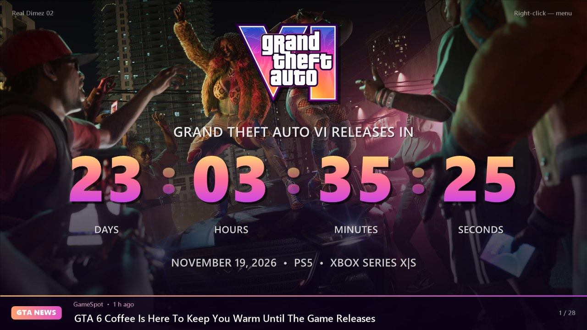
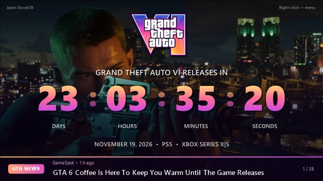
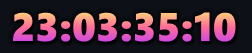
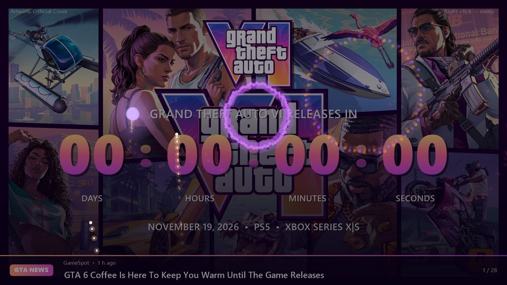

<p align="center"><a href="README.md">Русский</a> | <b>English</b></p>

# GTA VI Countdown

[](#download-and-run)
[](#building)
[](LICENSE)
[](https://github.com/OlegChe77/GTA6Timer/releases/latest)
[](https://github.com/OlegChe77/GTA6Timer/releases)

A countdown timer for Windows to the release of **Grand Theft Auto VI** (November 19, 2026, 00:00 local time). A borderless window shows a slideshow of official Rockstar screenshots with smooth transitions and a ticker of the latest GTA news at the bottom.



## Features

- **Slideshow.** 99 official screenshots from [rockstargames.com/VI/media](https://www.rockstargames.com/VI/media), changing every 10 seconds with a crossfade. The images are downloaded automatically on first launch (about 70 MB).
- **Any window size.** Drag the edges to resize; the window keeps its 16:9 aspect ratio and remembers its size and position. Fullscreen with F11 or a double-click.
- **News ticker.** GTA headlines from gaming site RSS feeds (IGN, GameSpot, Eurogamer, GamesRadar+, VGC and more; Russian sources in Russian mode). Refreshed on start and every 5 hours; click a headline to open the article.
- **Mini mode.** Instead of minimizing, the window turns into semi-transparent digits in the bottom-right corner of the screen, always on top. Double-click them to bring the big window back.
- **Fireworks at release.** When the countdown hits zero: a 5-second fireworks show with a fanfare and a "GTA VI is out!" title. It plays if the app is open at that moment or started within an hour after. Try it now with the "Test fireworks" menu item.
- **English and Russian.** Switch in the "Язык / Language" menu.
- Always on top, start with Windows.

| Small window | Mini timer in the corner | Fireworks |
|---|---|---|
|  |  |  |

## Download and run

1. Download `GTA6Timer-*.zip` from the [latest release](https://github.com/OlegChe77/GTA6Timer/releases/latest).
2. Unpack it into any folder you can write to (for example `Documents\GTA6Timer`, not `Program Files`).
3. Run `GTA6Timer.exe`. On first launch it downloads the screenshots and the logo from the Rockstar website.

The app is not code-signed, so Windows SmartScreen may show a warning: click "More info" → "Run anyway".

Requires .NET Framework 4.5 or later (already included in Windows 10 and 11).

### Controls

| Action | How |
|---|---|
| Menu | right-click |
| Fullscreen | F11, F, Enter or double-click |
| Next / previous image | → / ← (or Space) |
| Next / previous headline | N or ↓ / ↑ |
| Always on top | T |
| Mini mode | "Minimize" in the menu or Win+M; double-click the digits to go back |
| Exit | Esc |

You can add your own pictures to the `images/` folder: every `jpg`, `png` and `bmp` there joins the slideshow.

## Building

All you need is `csc.exe` from .NET Framework 4 (ships with Windows); no Visual Studio required. The code is C# 5.

```powershell
powershell -ExecutionPolicy Bypass -File build.ps1
```

The script draws the `app.ico` icon and builds `GTA6Timer.exe` from `src/GTA6Timer.cs`. The same by hand:

```powershell
& "$env:WINDIR\Microsoft.NET\Framework64\v4.0.30319\csc.exe" /nologo /target:winexe /optimize+ /codepage:65001 /win32icon:app.ico /out:GTA6Timer.exe /r:System.Windows.Forms.dll /r:System.Drawing.dll /r:System.Core.dll /r:System.IO.Compression.dll /r:System.IO.Compression.FileSystem.dll src\GTA6Timer.cs
```

Command-line switches for testing: `--test-show` (play the fireworks right away), `--mini` (start in mini mode).

## Copyright

This is an unofficial fan project, not affiliated with Rockstar Games or Take-Two Interactive. Grand Theft Auto, the GTA VI logo, screenshots and artwork belong to Rockstar Games / Take-Two Interactive. That is why they are not included in the repository or the release archive: the app downloads them from the official site [rockstargames.com/VI/media](https://www.rockstargames.com/VI/media) to your computer for personal, non-commercial use.

The code is licensed under the [MIT License](LICENSE).
