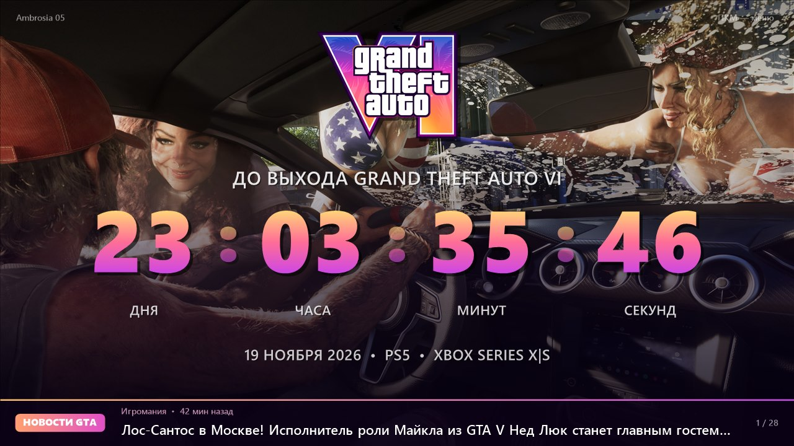
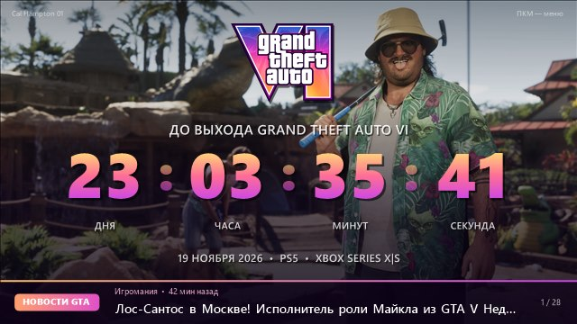
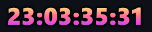
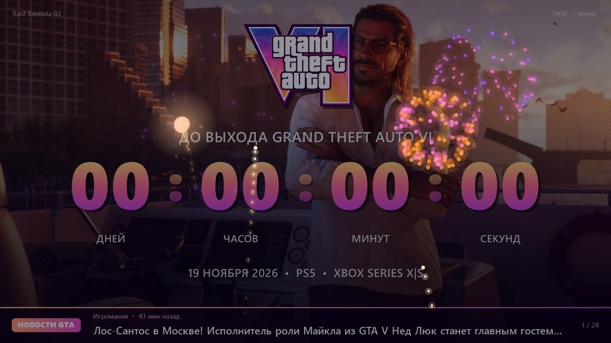

<p align="center"><b>Русский</b> | <a href="README.en.md">English</a></p>

# GTA VI Countdown

[](#как-скачать-и-запустить)
[](#как-собрать)
[](LICENSE)
[](https://github.com/OlegChe77/GTA6Timer/releases/latest)
[](https://github.com/OlegChe77/GTA6Timer/releases)

Таймер обратного отсчёта до выхода **Grand Theft Auto VI** (19 ноября 2026, 00:00 по местному времени) для Windows. Окно без рамки, на фоне — слайдшоу официальных скриншотов Rockstar с плавной сменой, внизу — свежие новости о GTA.



## Возможности

- **Слайдшоу.** 99 официальных скриншотов с [rockstargames.com/VI/media](https://www.rockstargames.com/VI/media), смена каждые 10 секунд с плавным переходом. Картинки скачиваются автоматически при первом запуске (около 70 МБ).
- **Окно любого размера.** Тянется за края с сохранением пропорций 16:9, размер и положение запоминаются. Полный экран по F11 или двойному клику.
- **Лента новостей.** Заголовки про GTA из RSS игровых сайтов (3DNews, PlayGround.ru, StopGame, Игромания; для английского языка свои источники). Обновление при запуске и раз в 5 часов, клик открывает статью.
- **Мини-режим.** Вместо сворачивания окно превращается в полупрозрачные цифры в правом нижнем углу экрана поверх всех окон. Двойной клик возвращает большое окно.
- **Фейерверк в момент выхода.** Когда отсчёт доходит до нуля: 5-секундный салют с фанфарами и надпись «GTA VI уже вышла!». Сработает, если программа открыта в этот момент или запущена в течение часа после. Проверить можно заранее: пункт меню «Тест фейерверка».
- **Русский и английский.** Переключение в меню «Язык / Language».
- Поверх всех окон, автозапуск вместе с Windows.

| Маленькое окно | Мини-таймер в углу | Фейерверк |
|---|---|---|
|  |  |  |

## Как скачать и запустить

1. Скачайте `GTA6Timer-*.zip` со страницы [последнего релиза](https://github.com/OlegChe77/GTA6Timer/releases/latest).
2. Распакуйте в любую папку, куда у вас есть права на запись (например, `Документы\GTA6Timer`, но не `Program Files`).
3. Запустите `GTA6Timer.exe`. При первом запуске программа скачает скриншоты и логотип с сайта Rockstar.

Программа не подписана, поэтому Windows SmartScreen может показать предупреждение: нажмите «Подробнее» → «Выполнить в любом случае».

Нужен .NET Framework 4.5 или новее (в Windows 10 и 11 он уже есть).

### Управление

| Действие | Как |
|---|---|
| Меню | правая кнопка мыши |
| Полный экран | F11, F, Enter или двойной клик |
| Следующая / предыдущая картинка | → / ← (или пробел) |
| Следующая / предыдущая новость | N или ↓ / ↑ |
| Поверх всех окон | T |
| Мини-режим | кнопка «Свернуть» в меню или Win+M; назад — двойной клик по цифрам |
| Выход | Esc |

Свои картинки можно добавить в папку `images/`: в слайдшоу попадают все `jpg`, `png` и `bmp` оттуда.

## Как собрать

Нужен только компилятор `csc.exe` из .NET Framework 4 (входит в Windows), Visual Studio не требуется. Код написан на C# 5.

```powershell
powershell -ExecutionPolicy Bypass -File build.ps1
```

Скрипт рисует иконку `app.ico` и собирает `GTA6Timer.exe` из `src/GTA6Timer.cs`. То же вручную:

```powershell
& "$env:WINDIR\Microsoft.NET\Framework64\v4.0.30319\csc.exe" /nologo /target:winexe /optimize+ /codepage:65001 /win32icon:app.ico /out:GTA6Timer.exe /r:System.Windows.Forms.dll /r:System.Drawing.dll /r:System.Core.dll /r:System.IO.Compression.dll /r:System.IO.Compression.FileSystem.dll src\GTA6Timer.cs
```

Ключи запуска для проверки: `--test-show` (сразу показать фейерверк), `--mini` (запуститься в мини-режиме).

## Права на материалы

Это неофициальный фанатский проект, он не связан с Rockstar Games и Take-Two Interactive. Grand Theft Auto, логотип GTA VI, скриншоты и арты принадлежат Rockstar Games / Take-Two Interactive. Поэтому их нет ни в репозитории, ни в архиве релиза: программа скачивает их с официального сайта [rockstargames.com/VI/media](https://www.rockstargames.com/VI/media) на ваш компьютер для личного некоммерческого использования.

Код распространяется по лицензии [MIT](LICENSE).
